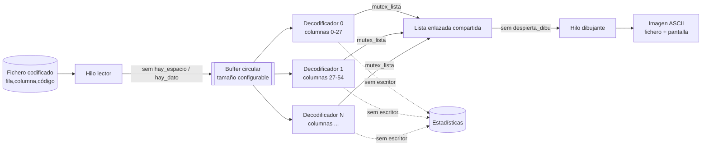

<div align="center">

# Minishell y decodificador concurrente en C

**Un intérprete de órdenes con `fork`/`exec` y un decodificador de imágenes ASCII multihilo con buffer circular y semáforos POSIX**


<sub>Fundamentos de Sistemas Operativos · Grado en Ingeniería Informática · Universidad de Valladolid · Curso 2022-2023</sub>

</div>



## En pocas palabras

- **Reto:** reconstruir una imagen a partir de un fichero desordenado y lleno de líneas no válidas, repartiendo el trabajo entre varios hilos sin condiciones de carrera.
- **Solución:** un hilo lector, N hilos decodificadores y un hilo dibujante coordinados con un buffer circular, semáforos y un mutex; además, un minishell que ejecuta órdenes en procesos hijo.
- **Demuestra:** programación concurrente, sincronización (productor-consumidor), llamadas al sistema POSIX y gestión de memoria dinámica en C.

## Lo más destacado

- **Productor-consumidor con buffer circular** de tamaño configurable, sincronizado con los semáforos `hay_espacio` y `hay_dato`.
- **Reparto de columnas entre hilos:** cada decodificador atiende un rango `[col_ini, col_fin)` y las columnas sobrantes se reparten entre los primeros hilos. Si un hilo lee un dato de otra columna, lo devuelve al buffer sin consumirlo.
- **Terminación limpia:** el lector escribe una marca de fin (`fil = -1`) para que todos los decodificadores terminen.
- **Filtrado de datos:** descarta las líneas fuera de rango y los caracteres no imprimibles; con `csmile.txt` el lector procesa 60 865 líneas y descarta 28 868.
- **Estadísticas por hilo** escritas en exclusión mutua mediante el semáforo `escritor`.
- **Minishell sobre llamadas al sistema:** lee la orden byte a byte con `read(0, ...)` y la ejecuta con `fork`, `execvp` y `wait`.

## Competencias

| Área | Qué se aplicó |
|------|---------------|
| Concurrencia | `pthread`, reparto del trabajo entre N hilos |
| Sincronización | Semáforos POSIX, mutex, patrón productor-consumidor |
| Procesos | `fork`, `execvp`, `wait` |
| Programación en C | E/S de bajo nivel, listas enlazadas, matrices dinámicas |

## Qué hace

- **Entrega 1 — minishell:** muestra el prompt `minishell>> `, lee una orden de la entrada estándar y la ejecuta en un proceso hijo. Admite `ls` y `cat` con un parámetro como máximo, avisa de que ignora el resto de parámetros y termina con `salir`.
- **Entrega 2 — decodificador concurrente:** lee un fichero codificado (una línea por carácter con `fila,columna,código`), reconstruye la imagen ASCII y la escribe en un fichero de salida y por pantalla. En un fichero de estadísticas anota cuántas líneas y caracteres ha procesado cada hilo.

## Arquitectura

- El **hilo lector** produce datos en el buffer circular; los **decodificadores** los consumen según su rango de columnas.
- Los caracteres válidos se añaden a una **lista enlazada compartida** protegida por `mutex_lista`.
- El **hilo dibujante** espera en el semáforo `despierta_dibu` cada carácter nuevo y compone la imagen en una matriz dinámica.

## Estructura del repositorio

```
FSO/
├── Entrega1/
│   └── p1-fso.c        # minishell (ls / cat)
└── Entrega2/
    ├── p2-fso.c        # decodificador concurrente
    ├── csmile.txt      # imagen codificada de ejemplo
    └── cdarth.txt      # imagen codificada de ejemplo
```

## Requisitos

- Linux o cualquier sistema POSIX
- GCC con soporte para `pthread`

## Cómo ejecutarlo

<details>
<summary>Entrega 1 — minishell</summary>

```bash
gcc -o p1 Entrega1/p1-fso.c
./p1
minishell>> ls -l
minishell>> salir
```

</details>

<details>
<summary>Entrega 2 — decodificador concurrente</summary>

Recibe cinco parámetros: fichero codificado, fichero de salida, tamaño del buffer, número de hilos decodificadores y fichero de estadísticas.

```bash
gcc -pthread -o p2 Entrega2/p2-fso.c
./p2 Entrega2/csmile.txt salida.txt 5 3 datos.txt
```

Extracto de `datos.txt` obtenido con ese comando (el orden de los hilos puede variar entre ejecuciones):

```
Hilo Lector
Líneas procesadas: 60865
Lineas correctas: 31997
Lineas no validas: 28868
ID Hilo Decodificador: 0
Columnas asignadas: 0-27
Caracteres totales:10784
Caracteres validos: 1080
Caracteres invalidos: 9704
```

</details>

Ambos programas se han probado con GCC en Linux: la entrega 2 reconstruye la imagen de `csmile.txt` y genera las estadísticas de cada hilo.

## Estado y limitaciones

- El minishell solo admite `ls` y `cat`, con un parámetro como máximo; no implementa tuberías ni redirecciones.

## Autoría

Trabajo en grupo (grupo de laboratorio X2). Según la cabecera de los ficheros fuente, sus autores son Javier García González y Diego Stefano Wortman Rueda.

---

<div align="center"><sub>Parte de <a href="https://github.com/JavivuG/UVa-Projects">UVa-Projects</a> · Javier García González</sub></div>
